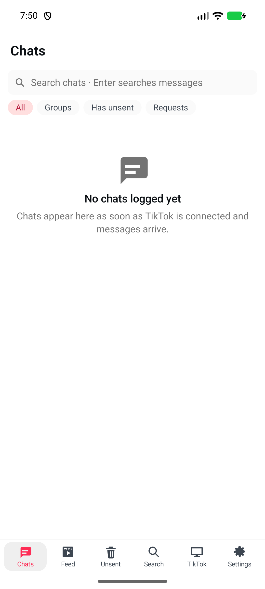
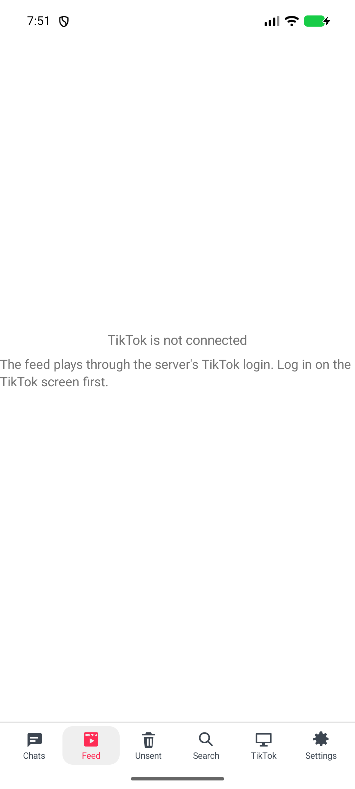
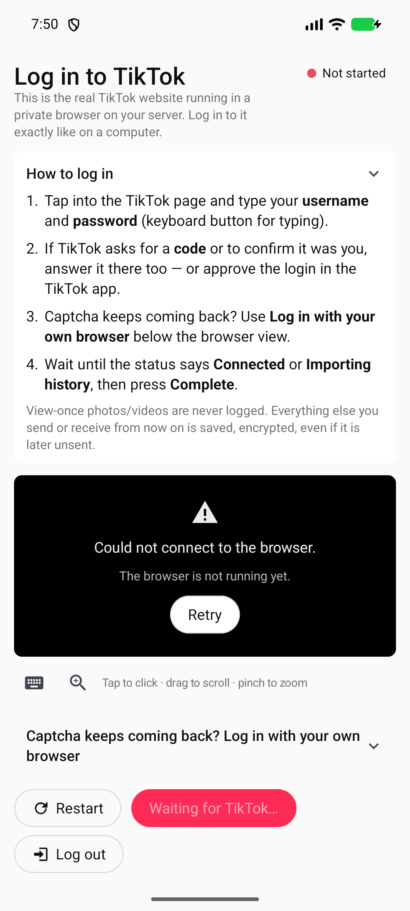
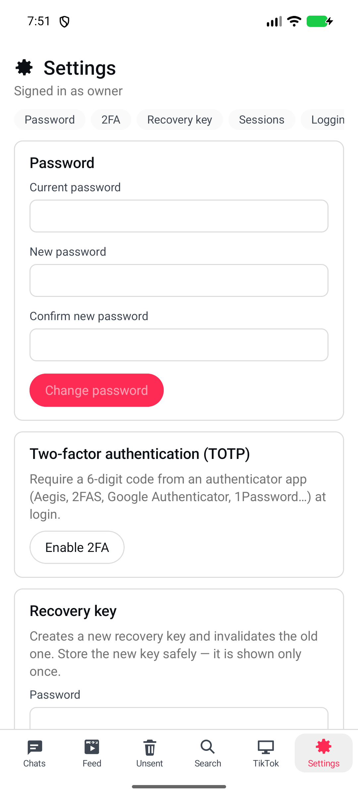

# tiktok_logger for Android

A native Android client (Kotlin, Jetpack Compose) for your self-hosted
[tiktok_logger](https://github.com/revocx35/tiktok_logger) server. It looks like the server's web UI (TikTok's red and
cyan, light and dark), but it is a real app: native lists and media playback, a native view of the server's TikTok
browser, and the session kept in the Android Keystore.

**The phone never talks to TikTok.** Chats, sending, media and the For You feed all go through your server, so TikTok
only ever sees the server's browser and IP address.

The icon and the in-app mark are the server's own logo (the cyan→red tile with a white shield used by the web UI).

| Chats | Feed | TikTok screen | Settings |
|---|---|---|---|
|  |  |  |  |

*(Screens from the emulator against a test server: no TikTok account is connected there, so the lists are empty.)*

## Features

Through the same server API as the web UI (`shared/api.d.ts` of tiktok_logger):

- **Setup:** connect to your server, sign up with the setup token, save the recovery key, log in to TikTok (live
  browser view, status, *Complete*), or paste cookies from your own browser (`/api/tt/session`), log in with 2FA,
  recover with the recovery key.
- **Chats:** the chat list with search and filters (All / Groups / Has unsent / Requests), unsent counts, the chat log
  with day separators, sender colours in groups, links, replies (tap to jump), shared videos/profiles/live links,
  music markers, in-chat search, and **messages deleted on TikTok kept with a red frame**.
- **Media:** photos (full screen, pinch to zoom), videos (streamed with Range requests), voice messages (inline
  player). Failed / too large / expired media can be retried.
- **Sending:** text, replies and photos/videos/voice messages (Android 10+), all typed into TikTok's own composer by
  the server, then confirmed by re-reading the chat.
- **Feed:** TikTok's For You as the server sees it — one video at a time, swipe up/down (or the arrows) to move, tap to
  pause, ♥ to like/unlike, comments (with their replies) and **Send**, which puts the video's link into one of your
  chats, and a **Fit / Fill** button next to them that switches between the whole video with black bars and a video
  cropped to the screen (the choice is remembered). Playback is streamed through the server; nothing of the feed is
  stored.
- **Stories:** the stories the server logged for the accounts you follow — a row of accounts with their story counts, a
  grid of photos and videos, a full-screen viewer (swipe between them, videos play once, photos hold five seconds), and a
  **download** button on each story that saves it to the phone's gallery as `story_@user_<date>.<ext>`. "Check now" runs a
  capture pass on the server; nothing is marked as seen.
- **Multi-account:** add as many servers (or users on a server) as you like and switch between them from
  **Settings → Account** (or the account icon at the bottom of the tablet rail) — each keeps its own sign-in, so
  switching does not sign anything out. **Add another account** opens the same server screen; **Change server** there replaces a
  server you never signed in on (a mistyped address leaves nothing behind) or adds one once your account works.
- **Unsent** feed, global **Search**, **TikTok** (live view of the server's browser: tap = click, drag = scroll,
  pinch = zoom, keyboard, view-only switch, restart, log out), **Settings** (account, password, 2FA, recovery key,
  sessions, logging options, reconcile interval, TikTok connection, security log, wipe).
- **Live updates** over the server's event stream while the app is open.
- Phones get the bottom menu, tablets / landscape (≥ 900 dp) get the side rail and two panes.

## Multiple accounts (0.4.0)

One phone can hold several tiktok_logger accounts — another server (the homelab box and the VPS, say) or another
user on the same server — and switch between them without signing out:

- **Where:** the **Account** section at the top of Settings shows the account you are in (name, server address);
  tapping it, **Switch account**, or the account icon at the bottom of the tablet rail opens the account menu. Each
  account in the menu shows its user name (or host:port) and server, with the open one marked; **Add another account**
  goes to the server screen (where you can check the address, trust a certificate and sign in with authentik before
  saving). The same **Switch account** link is on the sign-in screen, so an account that is not signed in is never a
  dead end.
- **Switching** closes the current session and opens the other one with its own cookie and authentik tokens. Nothing
  is signed out, and the tab state is rebuilt for the account (`key(session.id)`), so a chat or feed position opened on
  one server never shows the other's data.
- **Secrets stay apart:** `SecureCookieJar` and `KeystoreAuthentikStore` are created per account id
  (`session-<id>.bin`, `authentik-<id>.bin`, all encrypted with the one Keystore AES-GCM key), and a removed account's
  files are deleted. Trusted certificates are stored **per host**, so trusting a self-signed certificate for one server
  never widens trust for another.
- **Migration:** an install with the single saved server becomes the first account (`Account.MAIN`), which keeps the
  old file names (`session.bin`, `authentik.bin`) and its trusted certificates — updating does not sign anyone out or
  ask for a certificate again.

## Build

```sh
export ANDROID_HOME=/path/to/android-sdk   # platform 36, build-tools 36.0.0
./gradlew :core:test :app:testDebugUnitTest :app:assembleDebug
```

The debug APK lands in `app/build/outputs/apk/debug/app-debug.apk`. A release APK is built and attached by the
release workflow when a `v*` tag is pushed; it is signed with the keystore in `KEYSTORE_BASE64` (plus
`KEYSTORE_PASSWORD`, `KEY_ALIAS`, `KEY_PASSWORD` secrets).

## Server

The app expects a tiktok_logger server (the same hostname you use in the browser). If the server sits behind authentik
(Nginx Proxy Manager forward auth), the app signs in with authentik once — see [docs/authentik.md](docs/authentik.md);
the default client id is `tiktoklogger-android`.

## Notes

- Reading a chat marks it seen on TikTok. That is what logging from outside has to do; the web UI says the same.
- Nothing is stored on the phone beyond the session cookie and the (optional) auto-saved media; the log itself lives
  encrypted on the server.
